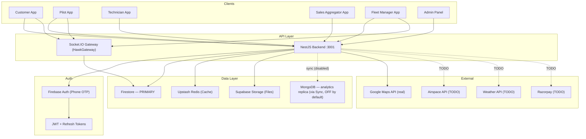
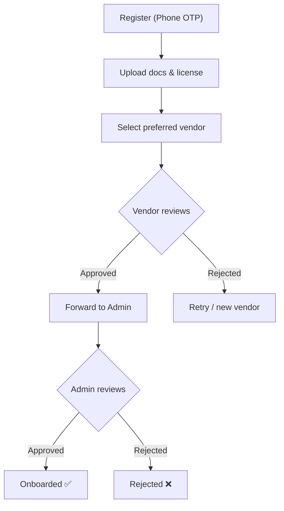
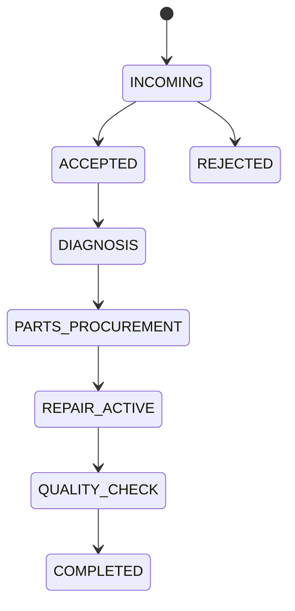
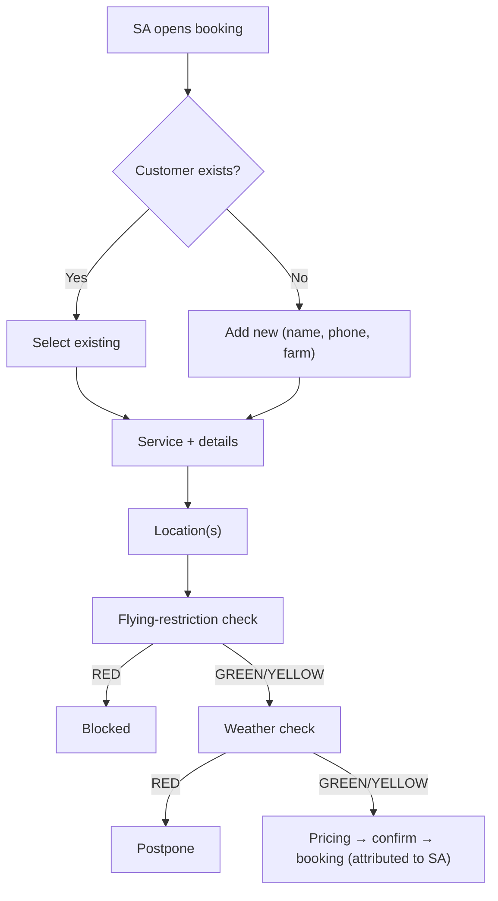
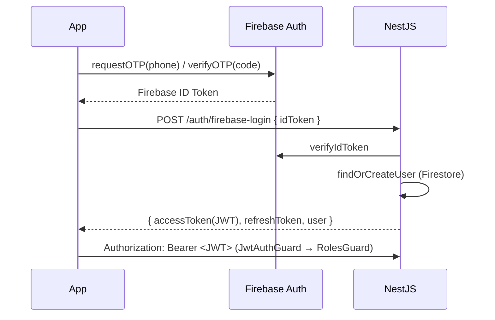
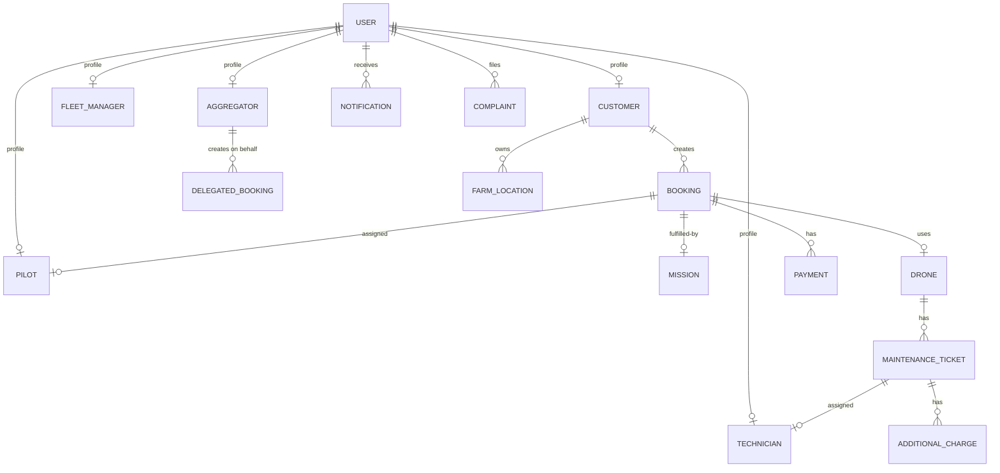

# Hawk Aerosystem — Backend System Design & Architecture

> Backend architecture for **Customer, Pilot, Technician, Sales Aggregator, Fleet Management, and Admin** modules.
> **This revision is reconciled against the actual codebase** (24 NestJS modules, Firestore-primary), the Figma set (521 screens across 5 role folders), and the architecture PPTX. Where the previous draft described intent, this version marks what the code *actually does* vs. what still needs building.

---

## Table of Contents

1. [System Overview & Current State](#1-system-overview--current-state)
2. [Architecture Principles](#2-architecture-principles)
3. [Customer Module](#3-customer-module)
4. [Pilot Module](#4-pilot-module)
5. [Technician Module](#5-technician-module)
6. [Sales Aggregator Module](#6-sales-aggregator-module)
7. [Fleet Management Module](#7-fleet-management-module)
8. [Admin Module](#8-admin-module)
9. [Cross-Cutting Concerns](#9-cross-cutting-concerns)
10. [Data Model (Firestore-Primary)](#10-data-model-firestore-primary)
11. [Real-Time Architecture](#11-real-time-architecture)
12. [Scalability & Performance](#12-scalability--performance)
13. [Implementation Priority & Gaps](#13-implementation-priority--gaps)

---

## 1. System Overview & Current State

### Tech Stack (corrected against code)

| Layer | Technology | Real Status |
|-------|-----------|-------------|
| Framework | NestJS 10 (TypeScript) | ✅ Production-ready |
| **Primary DB** | **Firebase Firestore** (collections + user subcollections) | ✅ **This is the source of truth** |
| Secondary DB | MongoDB 7 (Mongoose) — analytics/reporting read-replica | ⚠️ Populated **only** via Sync module, which is **disabled by default** (`FIRESTORE_SYNC_ENABLED=false`) |
| Auth | Firebase Phone Auth → JWT (+ refresh) | ✅ Working |
| WebSocket | Socket.IO via `@nestjs/websockets` (`HawkGateway`) | ✅ Implemented (rooms, GPS relay, auth guard) |
| Cache | Upstash Redis (serverless) + in-memory fallback | ✅ Working |
| File Storage | Supabase Storage | ✅ Working |
| Maps | Google Maps (geocode, reverse-geocode, distance-matrix, directions) | ✅ **Real** integration |
| Airspace / Flying-restriction | — | ❌ **Not integrated** (endpoint reads a collection stub) |
| Weather | — | ❌ **Not integrated** (endpoint reads a collection stub) |
| Push (FCM) | — | ❌ **Not implemented** (in-app + WebSocket only) |
| SMS / Email | — | ❌ Not implemented |
| Payments | Payment module (cash/upi/wallet status only) | ❌ **No gateway** — hardcoded UPI QR, no webhook |

> **Correction from prior draft:** The previous version listed MongoDB/Mongoose as the primary DB and FCM as "working." Neither is true in code. The system is **Firestore-first**; MongoDB is an optional, currently-off sync target. FCM/SMS/email are absent.

### Module Implementation Status (re-scored against code)

| Module | Real % | What actually exists | Critical gaps |
|--------|--------|----------------------|---------------|
| Auth | ~85% | Firebase phone → JWT, refresh, roles | Device/session tracking |
| Users | ~80% | CRUD, role data | Bulk ops, advanced search |
| Booking | ~65% | Create, list, cancel, assign, 5-state machine, price lock, history+CSV | 7-stage tracking, real airspace/weather, per-service fields, delivery two-location |
| Customer | ~45% | Admin-style CRUD, read farms/bookings/tickets, stats | Farm **write** CRUD, rating, service discovery, self-service profile, refunds |
| Pilot | ~50% | Onboard (w/ docs), missions list, accept, status update, mission report, price lock | Stage granularity, auto-assign, GPS persistence, earnings dashboard, doc review |
| Technician | ~25% | Onboard, profile, list, **read** maintenance tickets | **Entire repair workflow**: incoming tickets, stage transitions, additional charges, UPI QR |
| Aggregator | ~55% | Onboard, add+link customer, delegated booking, flat commission, SA approval flow | Commission tiers, territory, analytics charts |
| Fleet | ~45% | Drone CRUD, maintenance logging, dashboard counts, FM approve/reject | Mission assignment, drone-pilot match, resources inventory, maintenance stages |
| Admin | ~40% | Admin CRUD, audit log, department/permission scaffolding | **verify/ban not implemented**, settlement, analytics engine |
| Payment | ~20% | Initiate/confirm/invoice/list (status only) | Gateway (Razorpay), webhook, real capture |
| Revenue | ~55% | Commission calc (10% platform / 5% SA), dashboards, charts, CSV/PDF stub | Settlement batch processing |
| Maps | Google ✅ / Airspace ❌ / Weather ❌ | Google geocode/route/distance real | Airspace + weather providers |
| Notification | ~35% | Firestore in-app + WebSocket broadcast | FCM push, SMS, email |
| Marketplace | ~40% | Scaffolding | Service/product catalog |
| Dashboard | ~55% | Real queries + hardcoded baselines, cached | Remove hardcoded baselines |
| Reward | ~30% | Scaffolding | Loyalty engine |
| Service Centre | ~30% | Scaffolding | Centre management |
| Sync | **Disabled** | Firestore→MongoDB bidirectional sync (26 collections) exists but off by default | Decide role (see §10) |

### Current Architecture (corrected)



---

## 2. Architecture Principles

### Core Design Rules

1. **Firestore is the system of record.** All writes go to Firestore (root collections + `users/{uid}/…` subcollections). MongoDB, if enabled, is a downstream read-replica for heavy analytics only — never written to directly by feature code.
2. **Explicit, server-validated state transitions.** Entities carry a single `status` field plus, where the UI needs finer granularity, a `stage` sub-field. Transitions are validated against a table (as `booking-status.enum.ts` already does with `canTransitionBookingStatus`). **No proliferation of one-verb-per-stage endpoints.**
3. **Domain isolation.** Each module owns its collection, service, controller. Cross-module communication via NestJS `EventEmitter` (async) or direct service injection (sync).
4. **Cache-first reads.** Hot data (pricing, catalog, profiles, dashboards) cached in Redis with per-volatility TTLs.
5. **Real-time via rooms.** WebSocket rooms per entity (`booking:{id}`, `user:{uid}`, `vendor:{id}`, `role:{role}`). No broadcast storms.
6. **Idempotent mutations.** State transitions use `status` preconditions on the Firestore write so a repeated request can't double-advance.

### Request Flow

```
Client → Helmet → CORS → ThrottlerGuard → JwtAuthGuard → RolesGuard
       → ValidationPipe → Controller → Service → Firestore
       → TransformInterceptor → Response { success, data, timestamp }

Errors → HttpExceptionFilter → { success: false, error: { code, message } }
State changes → AuditInterceptor → audit_logs (admin actions already logged)
```

### Route Convention (align these — currently inconsistent)

Code today mixes self-service (`PATCH /technicians/me`) with admin-style (`/customers/:uid`). Standardize by audience:

- **Mobile role apps** (customer/pilot/technician/aggregator/fleet-manager acting as themselves): `/<role>/me`, `/<role>/missions`, etc. — identity from JWT, never a path param.
- **Admin panel** (managing others): `/admin/<role>/:id`, `/fleet-managers/:id`, `/sa-management/...`.

The API designs below use the mobile-self-service shape for role apps.

### Role Hierarchy

```
SUPER_ADMIN > ADMIN > SUB_ADMIN > VENDOR > FLEET_MANAGER > SALES_AGGREGATOR > PILOT > TECHNICIAN > CUSTOMER
```

Users may hold **multiple roles** and switch active role. (Switch-role overlays exist across the Figma set.)

---

## 3. Customer Module

### 3.1 Current State

`customer.module.ts`. Today it is **admin-CRUD oriented**: `POST/GET/PATCH/DELETE /customers`, `GET /customers/:uid/{bookings,farms,support-tickets}`, `/customers/stats`, ban. Farms, bookings and tickets are **read-only** here. Flying-restriction and weather live in the **booking** module as collection stubs. There is no self-service `/customers/me` profile, no farm write CRUD, no rating, no service discovery.

### 3.2 Figma-Derived Functionality (176 customer screens)

#### Service Types & Booking Flows

| Service | Unique Fields (per Figma) | Location Input | Pre-checks |
|---------|---------------------------|----------------|------------|
| **Spraying** | cropType (CropsList overlay), area (acre/ha/sqm), specialInstructions | Single farm (map + text) | Flying restriction, Weather |
| **Mapping** | mappingType (Infrastructure dropdown), area | Single location | Flying restriction, Weather |
| **Surveillance** | surveillanceType, area, duration | Single location | Flying restriction (red/yellow/green), Weather |
| **Videography** | videographyType, duration | Single location | Flying restriction, Weather |
| **Delivery** | weight, dimensions, contents | **Source + destination (two locations)** | Flying restriction on route |

> **Gap flagged:** Booking schema currently stores only `serviceType / area / cropType`. The per-service field bags and the delivery **two-location** model are **not** present. Add a `serviceDetails` map + optional `dropoffLocation`.

#### Booking Lifecycle — code today vs. Figma target

**Code today** (`booking-status.enum.ts`): 5 flat states.

```
pending → confirmed → in_progress → completed
   ↓          ↓            ↓
        cancelled (from pending/confirmed/in_progress)
```

**Figma target** (BookingDetailsStage01–07, per service): 7 display stages. **Implement as the same `status` field plus a `stage` sub-field** (1–7) for UI, not as new statuses/endpoints:

| stage | UI meaning | driven by |
|-------|-----------|-----------|
| 1 | Submitted / confirming | status=pending→confirmed |
| 2 | Pilot assigned | assignedPilot set |
| 3 | Pilot en route | mission status |
| 4 | Mission active | mission status=started |
| 5 | Mission complete, media pending | mission report |
| 6 | Payment pending | payment initiated |
| 7 | Completed | payment confirmed |

This keeps the write model simple (one status machine) while giving the app its 7-step tracker.

#### Pre-Booking Checks (on nearly every booking screen)

**Flying Restriction** → `GREEN` proceed / `YELLOW` proceed-with-warning / `RED` blocked.
**Weather** → `GREEN` favorable / `YELLOW` marginal / `RED` postpone.

> **Both are stubs today.** Figma has dedicated RedZone/YellowZone booking variants, so tri-state must be real. This is the highest-value functional gap (§13, P0).

### 3.3 API Design (self-service shape)

```
# Profile & Settings
GET    /customers/me
PATCH  /customers/me
PATCH  /customers/me/notification-settings
DELETE /customers/me                                  → deletion request

# Farm Locations  (ADD write ops — only read exists today)
GET    /customers/me/farms
POST   /customers/me/farms
PATCH  /customers/me/farms/:farmId
DELETE /customers/me/farms/:farmId

# Booking Flow
POST   /customers/me/bookings
GET    /customers/me/bookings                         (filters: status, serviceType, dateRange)
GET    /customers/me/bookings/:id                     (tracking, media, pricing)
PATCH  /customers/me/bookings/:id                     (editable pre-confirmation only)
POST   /customers/me/bookings/:id/cancel              (with refund calc)
POST   /customers/me/bookings/:id/rate

# Pre-Booking Checks  (make real)
POST   /bookings/flying-restriction-check             → { zone: GREEN|YELLOW|RED, details }
POST   /bookings/weather-check                        → { status: GREEN|YELLOW|RED, forecast }

# Pricing estimate (expose existing PricingService)
POST   /bookings/price-estimate                       → { baseAmount, travel, tax, total, breakdown }

# Notifications / Stats
GET    /customers/me/notifications
PATCH  /customers/me/notifications/:id/read
GET    /customers/me/stats
```

### 3.4 Business Logic

#### Price Calculation (PricingService exists; expose as estimate endpoint)

```
Input: serviceType, area(sqm), cropType, location, date, time
1. base rule by serviceType
2. crop multiplier (spraying)
3. area tier: 0-5ac base | 5-25ac -10% | 25-100ac -15% | 100+ac -20%
4. travel = distance(nearest pilot → site) × per-km   [uses real Google distance]
5. time-of-day + seasonal surcharge
6. − coupon
7. + GST
→ { baseAmount, travelCharges, additionalCharges, discount, couponDiscount, taxAmount, totalAmount }
```

#### Cancellation / Refund (endpoint exists, refund logic does NOT)

```
> 24h              → 100% refund
12–24h             → 75%
6–12h              → 50%
< 6h               → 0%
after pilot dispatched → 0% + travel cost
```
Refund path is blocked until a real payment gateway exists (§9.3).

### 3.5 Gap Analysis

| Feature | Status | Priority |
|---------|--------|----------|
| Flying-restriction real API | ❌ stub | P0 |
| Weather real API | ❌ stub | P0 |
| Per-service fields + delivery two-location | ❌ not modeled | P0 |
| Farm write CRUD (create/update/delete) | ❌ read-only | P1 |
| Price-estimate endpoint (expose PricingService) | ⚠️ internal only | P1 |
| Cancellation refund logic | ⚠️ cancel only, no refund | P1 |
| Rating/review | ❌ | P1 |
| 7-stage tracker (`stage` sub-field) | ❌ 5 flat states | P1 |
| Service discovery by location | ❌ | P2 |
| Refunds screen data | ❌ | P2 |

---

## 4. Pilot Module

### 4.1 Current State

`pilot.module.ts` + `mission.service.ts`. Exists: `POST /pilots/onboard` (with documents), `GET /pilots/missions`, `GET /pilots/missions/:id`, `PATCH /pilots/missions/:id/accept`, `PATCH /pilots/missions/:id/status`, `POST /pilots/missions/:id/report`, `POST /pilots/missions/:id/lock-price`, `GET /pilots/rewards`. Admin-side pilot management is broad (`/admin/pilots/...`). Mission status is a flat enum; GPS points land in `mission.geoTrack` and are relayed live by the gateway but **not persisted as a trail** beyond the mission doc.

### 4.2 Figma-Derived Functionality (68 pilot screens)

#### Onboarding (page78_img1)


Document **upload** exists; the **review/approval workflow** (vendor→admin) is the gap.

#### Mission Stages — code vs Figma

**Code today:** `pending | accepted | rejected | out_for_service | started | completed | cancelled`.
**Figma (Active01–04, Completed01–03):** en-route → at-location → pre-flight → in-flight → complete → uploading → verified.

**Implement as `status` + `stage` sub-field**, advanced through **one** endpoint — not six:

```
PATCH /pilots/missions/:id/status   body: { stage }   # server validates transition table
```

Transition table (rejected if precondition unmet):

```
accepted → EN_ROUTE → AT_LOCATION → PRE_FLIGHT → IN_FLIGHT → COMPLETE
COMPLETE → UPLOADING_MEDIA → PENDING_VERIFICATION → VERIFIED
accepted/EN_ROUTE → CANCELLED (with reason)
```

#### Maintenance Ticket (pilot raises) — 5 stages

Figma: NewMaintenanceTicketForm + PilotMaintenanceTicketDetailsActiveStage01–05 + Completed. Pilot can **create** and **track**; today only reads exist.

### 4.3 API Design

```
# Profile & Onboarding
GET    /pilots/me
PATCH  /pilots/me
POST   /pilots/me/onboarding/documents
GET    /pilots/me/onboarding/status                  (PENDING|APPROVED|REJECTED)
POST   /pilots/me/apply-role

# Availability & Location
PATCH  /pilots/me/availability                       ({ isOnline })
# live GPS stays on WebSocket ('mission:gps'), NOT a REST spam endpoint

# Missions
GET    /pilots/me/incoming-requests                  (pending acceptance)  ← add
GET    /pilots/me/missions                           (filters)
GET    /pilots/me/missions/:id
PATCH  /pilots/me/missions/:id/accept
PATCH  /pilots/me/missions/:id/reject                (reason)
PATCH  /pilots/me/missions/:id/status                ({ stage })  ← single transition
POST   /pilots/me/missions/:id/report                (media/proof)
PATCH  /pilots/me/missions/:id/cancel                (reason)

# Earnings & Maintenance
GET    /pilots/me/earnings                           (total, by service, by period)
GET    /pilots/me/earnings/pending
GET    /pilots/me/earnings/history
PATCH  /pilots/me/payout-method
GET    /pilots/me/maintenance-tickets
POST   /pilots/me/maintenance-tickets
GET    /pilots/me/maintenance-tickets/:id

# Complaints / Settings / Role
GET|POST /pilots/me/complaints
PATCH  /pilots/me/notification-settings
POST   /pilots/me/switch-role
```

### 4.4 Business Logic

#### Mission Auto-Assignment (not built — P0)

```
Candidates: status=AVAILABLE, isOnline, approved, specialization⊇serviceType,
            licenseExpiry>date, vendor match (or marketplace)
Score: distance 40% + rating 25% + completion 20% + experience 15%
Offer top-3 simultaneously (first-accept wins);
no accept in 5min → escalate to fleet manager; none → notify customer with ETA.
```

#### Earnings Settlement

```
per completed mission: pilotEarning = total × PILOT_SHARE (config)
weekly cycle: aggregate pending − penalties → batch → admin approves → mark SETTLED
```
(Revenue module has the split rates; settlement **batch** is not built.)

### 4.5 Gaps

| Feature | Status | Priority |
|---------|--------|----------|
| Auto-assignment algorithm | ❌ | P0 |
| GPS trail persistence (Firestore + optional Mongo) | ⚠️ relay only | P0 |
| Onboarding doc review workflow | ⚠️ upload only | P0 |
| `stage` sub-field + transition table | ❌ flat status | P1 |
| Earnings dashboard + payout method | ⚠️ price-lock only | P1 |
| Pilot-raised maintenance ticket create/track | ⚠️ read only | P1 |
| Incoming-requests endpoint | ❌ (uses missions list) | P2 |
| Availability schedule | ❌ | P2 |

---

## 5. Technician Module

### 5.1 Current State

`technician.module.ts`. **Thinnest role module.** Exists: `POST /technicians/onboard`, `PATCH /technicians/me`, `GET /technicians`, `GET /technicians/:id`, `GET /technicians/:id/{maintenance-tickets,repaired-drones,support-documents}`, soft delete. Everything ticket-related is **read-only**. The full repair workflow from Figma is absent.

### 5.2 Figma-Derived Functionality (57 technician screens)

#### Service Ticket State Machine (5 stages)


Figma: IncomingTicketsList/Details, service-details-active-stage-1..5, before/after photos. Advance via **one** `PATCH /technicians/me/tickets/:id/stage { stage, notes, photos[] }`.

#### Additional Charges (additional-charges-form) — not built

```
during any active stage: technician submits { item, part?, parts+labor cost, photos[] }
→ fleet manager approves/rejects → if approved, added to ticket total → notify.
```

### 5.3 API Design

```
GET    /technicians/me
PATCH  /technicians/me

GET    /technicians/me/incoming-tickets               ← add
GET    /technicians/me/tickets                        (filters)
GET    /technicians/me/tickets/:id
PATCH  /technicians/me/tickets/:id/accept
PATCH  /technicians/me/tickets/:id/reject             (reason)
PATCH  /technicians/me/tickets/:id/stage              ({ stage, notes, photos[] })
POST   /technicians/me/tickets/:id/complete           (before/after photos required)

POST   /technicians/me/tickets/:id/additional-charges
GET    /technicians/me/tickets/:id/additional-charges

GET    /technicians/me/earnings                       (+ pending, history)
PATCH  /technicians/me/payout-method
GET    /technicians/me/upi-qr                          ← generate (Figma UPIQRCode)
GET|POST /technicians/me/complaints
PATCH  /technicians/me/notification-settings
```

### 5.4 Business Logic

```
SLA (auto-escalate on breach):
CRITICAL 50h | HIGH 100h | MEDIUM 168h | LOW 288h

Earnings per completed ticket:
base = estimatedCost × TECH_SHARE (e.g., 70%)
+ approved additionalCharges × TECH_SHARE
SLA met +5% / breached −10%
```

### 5.5 Gaps

| Feature | Status | Priority |
|---------|--------|----------|
| Incoming-tickets + accept/reject | ❌ | P0 |
| Stage transitions with photo validation | ❌ | P0 |
| Additional-charges submit → FM approve | ❌ | P0 |
| Before/after photo capture on complete | ❌ | P1 |
| Diagnosis report / parts tracking | ⚠️ `diagnosisNotes` field only | P1 |
| UPI QR generation | ❌ | P2 |
| SLA tracking & breach alerts | ❌ | P2 |

---

## 6. Sales Aggregator Module

### 6.1 Current State

`aggregator.module.ts` + `sa-management.controller.ts`. **Reasonably built.** Exists: `POST /aggregators/onboard`, `POST /aggregators/customers` (creates user + sets `managedByAggregatorId`), `GET /aggregators/customers`, `POST /aggregators/bookings` (delegated booking with `aggregatorId` attribution), `GET /aggregators/bookings`, `GET /aggregators/commission` (**flat 5%**), `GET /aggregators/notifications`. Admin-side SA request approval flow is complete (`/sa-management/requests/:id/accept|reject`).

### 6.2 Figma-Derived Functionality (136 screens — largest set)

The SA app mirrors the **entire customer booking flow** (all 5 services, 7 stages, flying-restriction + weather tri-state, booking confirmation per service) **plus** commission charts (BarLineChart) and customer management. So SA inherits every §3 booking gap (per-service fields, tri-state checks, 7-stage tracker) on top of its own.

#### Booking-on-Behalf



### 6.3 API Design

```
GET    /aggregators/me                 PATCH /aggregators/me
POST   /aggregators/me/onboarding/documents
GET    /aggregators/me/onboarding/status

GET    /aggregators/me/customers       POST /aggregators/me/customers
GET    /aggregators/me/customers/:id   PATCH /aggregators/me/customers/:id
GET    /aggregators/me/customers/:id/bookings

POST   /aggregators/me/bookings        (customerId required)
GET    /aggregators/me/bookings        GET /aggregators/me/bookings/:id
POST   /aggregators/me/bookings/:id/cancel
# reuse shared /bookings/flying-restriction-check, /bookings/weather-check, /bookings/price-estimate

GET    /aggregators/me/commission      (+ pending, history)
GET    /aggregators/me/dashboard       (today/week/month bookings, earnings, recent)
GET    /aggregators/me/analytics       (trends, service breakdown, customer growth)  ← charts
PATCH  /aggregators/me/payout-method
GET|POST /aggregators/me/complaints
POST   /aggregators/me/switch-role
```

### 6.4 Business Logic

#### Commission (today flat 5% — Figma implies tiers)

```
base: total × SA_RATE
tiers (performance): 0-50/mo 8% | 51-200 10% | 201-500 12% | 500+ 15%
settlement: bi-weekly
```
Ship flat-rate first (already done); add tiers as P1 config, not a rewrite.

### 6.5 Gaps

| Feature | Status | Priority |
|---------|--------|----------|
| Per-service booking + tri-state checks (shared w/ §3) | ❌ | P0 |
| Analytics dashboard charts | ❌ | P1 |
| Commission tiers | ⚠️ flat 5% | P1 |
| Territory / service-area management | ❌ | P1 |
| Document verification workflow | ⚠️ fields only | P1 |
| Customer consent for linking | ❌ | P2 |

---

## 7. Fleet Management Module

### 7.1 Current State

`fleet.module.ts` + `fleet-manager.controller.ts`. Exists: full **drone CRUD** (`POST/GET/PATCH/DELETE /fleet/drones`, `/available`, `/:id/status`, `/:id/assign`), maintenance logging (`POST /fleet/drones/:id/maintenance`, schedule, overdue), `GET /fleet/dashboard` (counts), incoming-requests, managers list. Admin-side FM management complete (approve/reject/stats/dashboard). Drone status enum: `deployable | assigned | under_maintenance | crashed`. **No mission assignment, no drone-pilot matching, no resource inventory, no maintenance stage tracking from FM side.**

### 7.2 Figma-Derived Functionality (85 screens)

#### FM Mission Flow (8 stages)

Figma shows 8 stages, but — as with pilot/booking — model as **`status` + `stage` sub-field**, not 8 endpoints:

```
BOOKING_RECEIVED → PILOT_ASSIGNED → DRONE_ASSIGNED → PRE_FLIGHT
→ EN_ROUTE → ON_SITE → MISSION_ACTIVE → MISSION_COMPLETE
```
Assignment is one call: `POST /fleet/missions/:id/assign { pilotId, droneId }`.

#### Drone Status Machine (matches code enum, extend RETIRED)

```mermaid
stateDiagram-v2
    [*] --> DEPLOYABLE
    DEPLOYABLE --> ASSIGNED --> DEPLOYABLE
    DEPLOYABLE --> UNDER_MAINTENANCE
    ASSIGNED --> UNDER_MAINTENANCE
    UNDER_MAINTENANCE --> DEPLOYABLE
    UNDER_MAINTENANCE --> RETIRED
    DEPLOYABLE --> RETIRED
```
(Code uses `crashed`; reconcile to `RETIRED`/`crashed` — pick one.)

### 7.3 API Design (additions in **bold**)

```
GET    /fleet/dashboard
# Drones (exists)
GET|POST /fleet/drones
GET|PATCH|DELETE /fleet/drones/:id
PATCH  /fleet/drones/:id/status
POST   /fleet/drones/:id/assign
GET    /fleet/drones/:id/maintenance
POST   /fleet/drones/:id/maintenance

**# Missions (add — currently no FM mission routes)**
**GET    /fleet/missions**                (tabs: active, upcoming, completed)
**GET    /fleet/incoming-missions**       (unassigned bookings)
**GET    /fleet/missions/:id**
**POST   /fleet/missions/:id/assign**     ({ pilotId, droneId })

**# Pilots in fleet (3-step add form)**
**GET    /fleet/pilots**    **POST /fleet/pilots**    **PATCH /fleet/pilots/:id/status**

**# Resources (batteries/accessories inventory)**
**GET|POST /fleet/resources**

# Maintenance tickets (add stage + charge approval)
GET    /fleet/maintenance-tickets
POST   /fleet/maintenance-tickets        (assign technician)
GET    /fleet/maintenance-tickets/:id
**POST   /fleet/maintenance-tickets/:id/approve-charges**

GET    /fleet/commission                 (+ pending, history)
GET|PATCH /fleet/profile
```

### 7.4 Business Logic

```
Drone-pilot matching (P0 — not built):
drones: DEPLOYABLE, type⊇serviceType, insured, hours<MAX, no time conflict
pilots: AVAILABLE, specialization⊇serviceType, license valid, no conflict
pair to minimize travel + prefer past pairing + balance workload → FM confirms/overrides

Drone health triggers (only 'overdue by hours' exists today):
flightHours>interval | idle>maxDays | battery cycles>max | pre-flight issue |
insurance/registration expiry<30d (warn)
```

### 7.5 Gaps

| Feature | Status | Priority |
|---------|--------|----------|
| FM mission routes + assign | ❌ | P0 |
| Drone-pilot matching | ❌ | P0 |
| 8-stage tracking (`stage` sub-field) | ❌ | P0 |
| Add-pilot 3-step form | ❌ | P1 |
| Maintenance additional-charge approval | ❌ | P1 |
| Resource inventory (batteries/accessories) | ❌ | P1 |
| Drone health monitoring/alerts | ⚠️ overdue-by-hours only | P1 |
| Utilization analytics | ❌ counts only | P2 |

---

## 8. Admin Module

### 8.1 Current State

`admin.module.ts`. Exists: admin CRUD with Firebase Auth integration, departments/states/permission-profiles scaffolding, subordinate queries, **audit logging** to `adminAuditLogs` (action, severity, old/new). **Important:** the `verifyUser`/`banUser` methods referenced by tests are **not implemented in the service** (tests are aspirational). Revenue dashboards/charts are real; settlement processing is not.

### 8.2 API Design

```
GET    /admin/dashboard
GET    /admin/users        GET /admin/users/:id
PATCH  /admin/users/:id/status      DELETE /admin/users/:id     ← implement verify/ban/suspend

# Approvals (wire to real service methods)
GET    /admin/pilots/pending        PATCH /admin/pilots/:id/{approve,reject}
GET    /admin/vendors/pending       PATCH /admin/vendors/:id/{verify,reject}
GET    /admin/aggregators/pending   PATCH /admin/aggregators/:id/{verify,reject}
GET    /admin/technicians/pending   PATCH /admin/technicians/:id/approve

GET    /admin/bookings   GET /admin/bookings/:id   GET /admin/bookings/analytics
GET    /admin/complaints ...  PATCH /admin/complaints/:id/{status,assign}

# Revenue & Settlements
GET    /admin/revenue                       (real)
GET    /admin/revenue/settlements           ← build batch grouping
POST   /admin/revenue/settlements/process   ← build
GET    /admin/revenue/export                (CSV real, PDF stub)

GET|POST|PATCH|DELETE /admin/{pricing,coupons,services}
GET|PATCH /admin/config
GET    /admin/audit-logs                    ← viewer over existing adminAuditLogs
```

### 8.3 Gaps

| Feature | Status | Priority |
|---------|--------|----------|
| verify/ban/suspend user (referenced, not implemented) | ❌ | P0 |
| Settlement processing workflow | ❌ | P0 |
| Analytics engine (trends/aggregation) | ⚠️ partial in revenue/dashboard | P1 |
| Audit-log viewer API (logs exist) | ⚠️ no read endpoint | P1 |
| Report export (CSV real / PDF stub) | ⚠️ | P1 |
| Bulk user ops | ❌ | P2 |
| Fix audit `ipAddress` (hardcoded 0.0.0.0) | ⚠️ TODO | P2 |

---

## 9. Cross-Cutting Concerns

### 9.1 Authentication (matches code)



### 9.2 Notification Architecture (reality + target)

```
Implemented today:  IN_APP (Firestore users/{uid}/notifications) + WebSocket broadcast
Missing:            PUSH (FCM), SMS (MSG91/Twilio), EMAIL (SendGrid)
```
Add providers behind a single `NotificationService.dispatch(channel, …)` so callers don't change when channels light up. Template engine (per-role, per-language, priority) is a P1–P2 layer, not a prerequisite.

### 9.3 Payment Gateway (TODO — currently a stub)

Today: `POST /payments/initiate` (cash/upi/wallet, hardcoded `upi://pay?pa=hawk@upi…` QR), `PATCH /payments/:id/confirm` (client-asserted, no verification). **No gateway, no webhook.**

Target — **Razorpay** (India, UPI):
```
1. booking → PAYMENT_PENDING
2. POST /payments/create-order → Razorpay order
3. client checkout → capture
4. POST /payments/webhook → verify signature → mark paid (server-side truth)
5. paid → booking stage 7 (COMPLETED) → revenue split (Revenue module rates already exist)
```
This unblocks refunds (§3.4) and pilot/SA settlement.

### 9.4 File Storage (matches code — Supabase)

```
Buckets: profile-images / documents / booking-media / maintenance-media / general
Flow: POST /files/upload-url → client uploads direct → POST /files/register → CDN URL
```

### 9.5 Complaint System (unified schema across roles)

```
{ complaintId, userId, userRole, relatedEntityType, relatedEntityId,
  type, description, attachments[], status(OPEN|IN_PROGRESS|RESOLVED|CLOSED),
  assignedTo, resolution, resolvedAt, priority }
SLA: CRITICAL 4h | HIGH 24h | MEDIUM 48h | LOW 72h
```

---

## 10. Data Model (Firestore-Primary)

> **Rewritten.** The prior draft specified MongoDB/Mongoose indexes; the code stores everything in Firestore. This section now describes the **actual** Firestore layout and the composite indexes it needs. MongoDB indexing is relevant **only** if the Sync replica is turned on for analytics.

### 10.1 Collection Layout

```
users/{uid}                                  ← core identity + role profileData
users/{uid}/bookings/{bookingId}             ← customer's bookings (subcollection)
users/{uid}/drones/{droneId}
users/{uid}/transactions/{txnId}
users/{uid}/notifications/{notifId}
users/{uid}/invoices/{id}
users/{uid}/adminActions/{id}

# Root collections
missions/{requestId}          payments/{id}         pricing_*/{id}
salesAggregators/{id}         delegatedBookings/{id} maintenanceTickets/{id}
fleet_managers/{id}           pilots/{id}            drones (collectionGroup)
coupons/{id}                  incidents/{id}         subadmins/{id}
revenueSnapshots/{id}         reward_*/{id}          service_tickets/{id}
adminAuditLogs/{id}
```

### 10.2 Entity Relationships (logical)



### 10.3 Firestore Composite Indexes (create in `firestore.indexes.json`)

```
bookings (collectionGroup):
  (status, createdAt desc)
  (serviceType, createdAt desc)
  (assignedPilot, status)
  (vendorId, serviceType, createdAt desc)     ← analytics
  (status, scheduledDate)                      ← upcoming missions
missions:            (pilotId, status), (bookingId)
drones (group):      (vendorId, status), (type, status)
maintenanceTickets:  (technicianId, status), (droneId)
notifications:       (isRead, createdAt desc)   [per-user subcollection]
payments:            (bookingId), (status)
salesAggregators:    (status, createdAt desc)
```
Geo: Firestore has no native `2dsphere`. For "nearest pilot" use **geohash range queries** (`geofire-common`) or delegate distance ranking to the existing Google Distance Matrix call — do **not** assume Mongo geo indexes.

### 10.4 MongoDB Replica (only if Sync enabled)

If `FIRESTORE_SYNC_ENABLED=true`, the Sync module mirrors 26 collections into MongoDB for heavy reporting. In that case add Mongo indexes matching §10.3. **Recommendation:** keep sync **off** until an analytics workload actually needs it; Firestore + Redis covers current scale.

---

## 11. Real-Time Architecture

### 11.1 WebSocket Rooms (matches `HawkGateway`)

```
user:{uid}          personal notifications
booking:{bookingId} stage/location updates (auth-checked join)
vendor:{vendorId}   fleet-wide alerts, drone status
role:{role}         role broadcasts (pilot/vendor/…)
admin:dashboard     admin alerts, pending approvals
```

### 11.2 Event Catalog (as emitted in code via `@OnEvent`)

```
booking:    created, assigned, status_changed, cancelled
mission:    accepted, rejected, started, location, completed
payment:    confirmed, failed
pricing:    price_locked
drone:      status_changed, assigned
maintenance:overdue, logged
ticket:     created, assigned, status_changed, sla_breach
incident:   reported, escalated, resolved
notification: new, broadcast
```

### 11.3 Location Tracking (correct the prior claim)

```
Client: emit('mission:gps', { lat, lng })  every ~5s
Gateway (handleMissionGps):
  - verify booking.assignedPilot === pilot.uid   ✅ (implemented)
  - relay to booking:{id} room                    ✅
  - PERSIST trail                                 ❌ TODO (P0)
```
Prior draft said the trail is written to Firestore + MongoDB; **it is not persisted yet** — only relayed. To add: debounce <5m moves, batch-write to `missions/{id}.geoTrack` every ~30s.

---

## 12. Scalability & Performance

### 12.1 Caching (Redis — TTLs)

| Data | TTL | Invalidation |
|------|-----|-------------|
| Service catalog | 10 min | on admin update |
| Pricing rules | 5 min | on admin update |
| User profile | 2 min | on profile update |
| Booking detail | 30 s | on stage change |
| Dashboard stats | 1–5 min | time-based |
| Airspace/weather | 15 min | time-based |
| Pilot availability | 10 s | on status change |

> Note: revenue dashboard caching is currently **commented out "for debugging"** — re-enable before load.

### 12.2 Performance Targets

| Operation | Target | Strategy |
|-----------|--------|----------|
| Booking creation | < 200ms | direct write + async notify |
| Stage transition | < 100ms | precondition write + WS broadcast |
| GPS update | < 50ms | WebSocket relay (no per-event DB) |
| Dashboard load | < 500ms | pre-agg + Redis |
| Search/filter | < 300ms | Firestore composite index + cursor page |
| File upload | < 2s | direct-to-Supabase signed URL |

### 12.3 Scaling Plan (right-sized — do NOT pre-build)

```
Now (single instance): NestJS → Firestore → Redis → Supabase
  Target: ~100 concurrent, ~50 bookings/day. This is where you are.

Growth: 2–4 NestJS instances + Socket.IO Redis adapter (sticky sessions).
  Firestore scales horizontally on its own.

Future (only if metrics demand): split Notification/Payment workers,
  BullMQ for retries/scheduling, enable Mongo analytics replica.
```
> **Cut from prior draft:** microservices split, MongoDB sharding by vendorId, full event-sourcing/CQRS. At ~50 bookings/day these are premature. Keep the note; don't build the infra.

### 12.4 Background Jobs

```
EventEmitter (current, sufficient):
  booking.created → notify + price
  booking.stage-changed → update dashboards, notify
  booking.completed → revenue split, trigger settlement
  mission.completed → update stats, drone hours
  payment.received → mark paid, split
Migrate to BullMQ only when ret/scheduling/rate-limit is actually needed.
```

---

## 13. Implementation Priority & Gaps

### 13.1 P0 — Critical (build next)

| # | Item | Module | Effort |
|---|------|--------|--------|
| 1 | Payment gateway (Razorpay) + webhook | Payment | 3–4 d |
| 2 | Airspace / flying-restriction real API (tri-state) | Maps/Booking | 2–3 d |
| 3 | Weather real API (tri-state) | Maps/Booking | 1–2 d |
| 4 | Per-service field bags + delivery two-location model | Booking | 2 d |
| 5 | Mission auto-assignment + drone-pilot matching | Pilot/Fleet | 3–4 d |
| 6 | GPS trail persistence (batched) | Gateway/Pilot | 1–2 d |
| 7 | Technician repair workflow (incoming→stages→complete) | Technician | 3–4 d |
| 8 | FM mission routes + assign + `stage` sub-field | Fleet | 2–3 d |
| 9 | Admin verify/ban/suspend (wire real methods) | Admin | 1–2 d |
| 10 | Revenue split → settlement batch | Revenue/Admin | 3–4 d |

### 13.2 P1 — Important

| # | Item | Module | Effort |
|---|------|--------|--------|
| 11 | Farm write CRUD + rating | Customer | 1–2 d |
| 12 | Cancellation refund logic (needs #1) | Booking/Payment | 2 d |
| 13 | Technician additional-charges → FM approval | Tech/Fleet | 1–2 d |
| 14 | Pilot earnings dashboard + payout method | Pilot | 2 d |
| 15 | Pilot-raised maintenance ticket create/track | Pilot | 1–2 d |
| 16 | FCM push provider | Notification | 1–2 d |
| 17 | SMS provider (MSG91/Twilio) | Notification | 1–2 d |
| 18 | SA analytics dashboard + commission tiers | Aggregator | 2–3 d |
| 19 | Fleet: add-pilot form + resource inventory | Fleet | 2–3 d |
| 20 | `stage` sub-field + transition tables (booking/mission) | Booking/Pilot | 2 d |
| 21 | Admin audit-log viewer + report export | Admin | 2 d |

### 13.3 P2 — Nice to Have

| # | Item | Module |
|---|------|--------|
| 22 | Email provider (SendGrid) | Notification |
| 23 | SLA tracking (technician) | Technician |
| 24 | UPI QR generation (technician) | Technician |
| 25 | Drone health monitoring rules | Fleet |
| 26 | Fleet utilization analytics | Fleet |
| 27 | Service discovery by location | Customer |
| 28 | Sub-admin permission matrix | SubAdmin |

### 13.4 P3 — Future

| # | Item |
|---|------|
| 29 | Multi-language (i18n) |
| 30 | Enable MongoDB analytics replica (Sync) |
| 31 | Mission replay / route history |
| 32 | Marketplace catalog |
| 33 | Reward / loyalty engine |
| 34 | BullMQ job migration |

### 13.5 Effort Summary

| Priority | Items | Days |
|----------|-------|------|
| P0 | 10 | 21–30 |
| P1 | 11 | 20–27 |
| P2 | 7 | 10–14 |
| P3 | 6 | 12–16 |
| **Total** | **34** | **63–87** |

> With 2 developers in parallel: **~8–10 weeks** for P0+P1 (production-ready MVP). This is longer than the prior "5–6 weeks" estimate because that estimate assumed MongoDB primacy, working FCM, and higher module completion than the code actually has — and it under-counted the missing technician workflow and the two safety-critical external integrations (airspace, weather).

---

## Verification Plan

### Automated Tests
```bash
npm run test:unit          # services, DTOs
npm run test:integration   # API endpoints against Firestore emulator
npm run test:e2e           # full flow (booking lifecycle)
```
> Note: some admin tests reference `verifyUser`/`banUser` that aren't implemented — either implement (P0 #9) or mark pending. Don't let aspirational tests read green.


### Manual Verification
- Deploy to staging.
- Walk each module's flow against its Figma folder (Customer 176 / SA 136 / Fleet 85 / Pilot 68 / Technician 57).
- Verify WebSocket events with multiple clients (customer + pilot + FM on one booking).
- Confirm tri-state airspace/weather returns RED/YELLOW/GREEN paths from real providers.
- Load test with k6 against §12.2 targets.
- Security pass: auth bypass, role escalation, Firestore rules, payment webhook signature.
